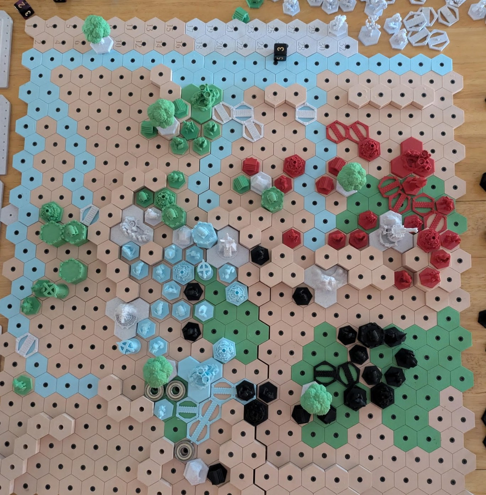
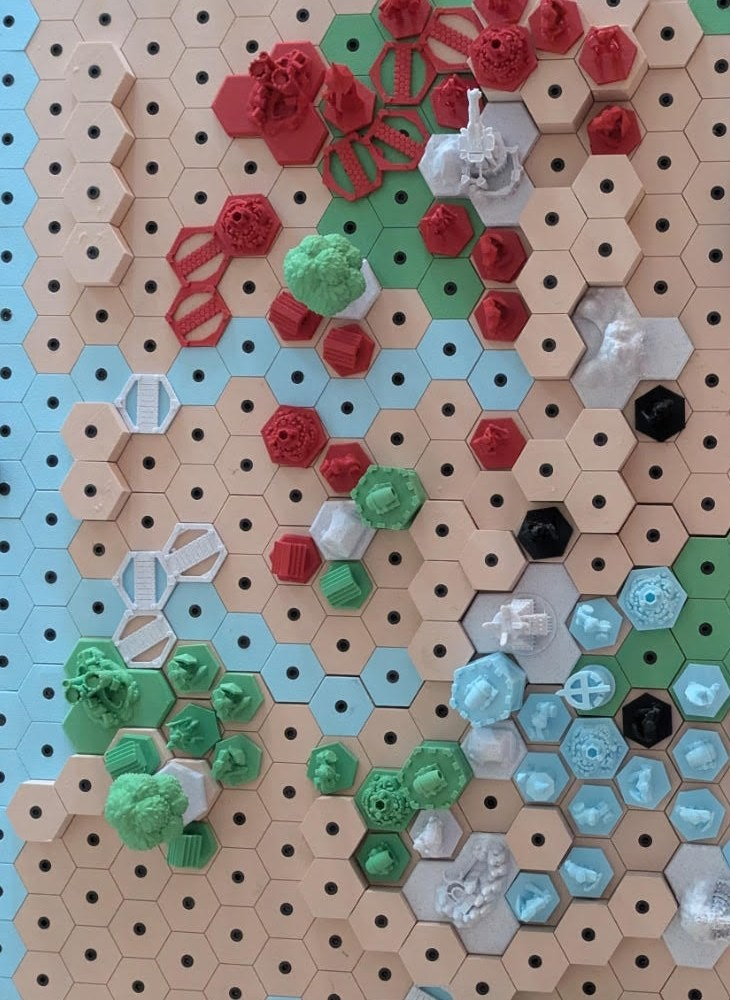
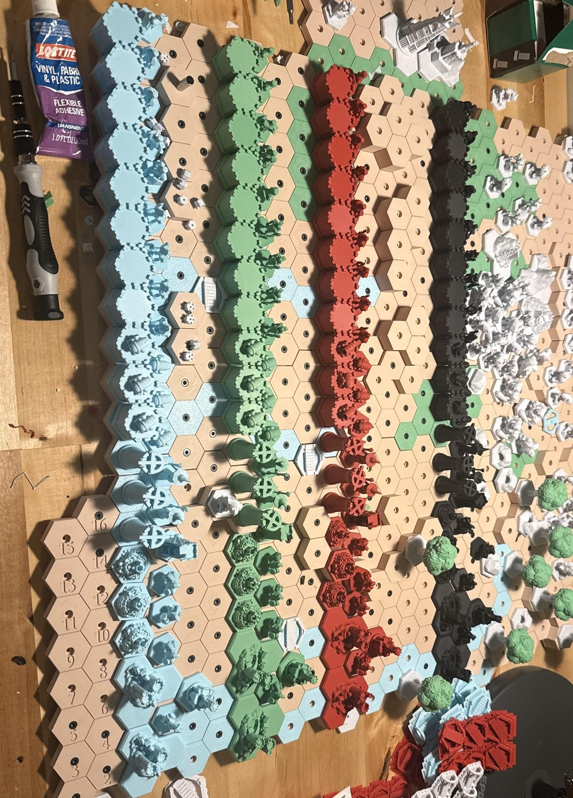
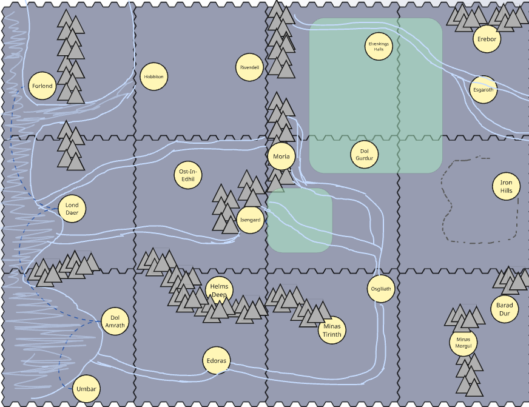
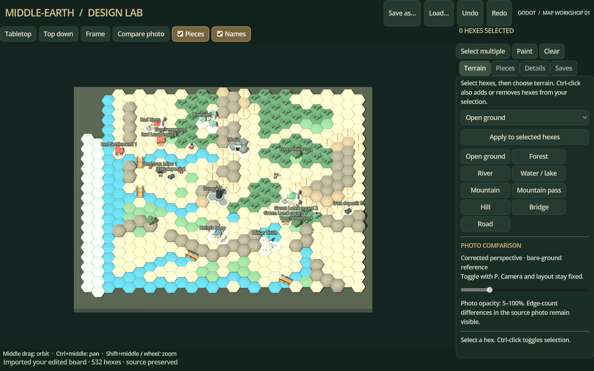
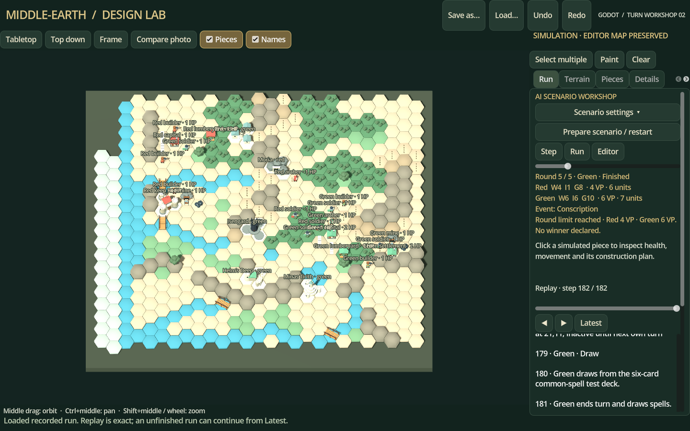
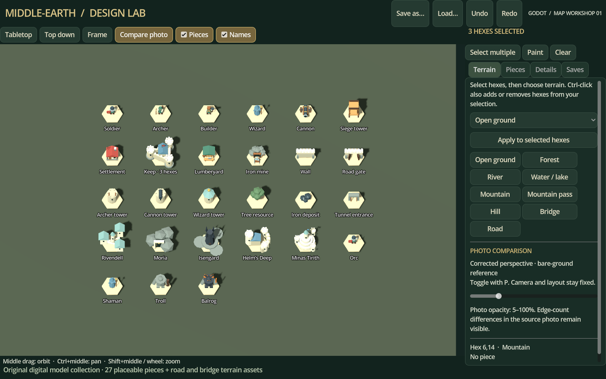
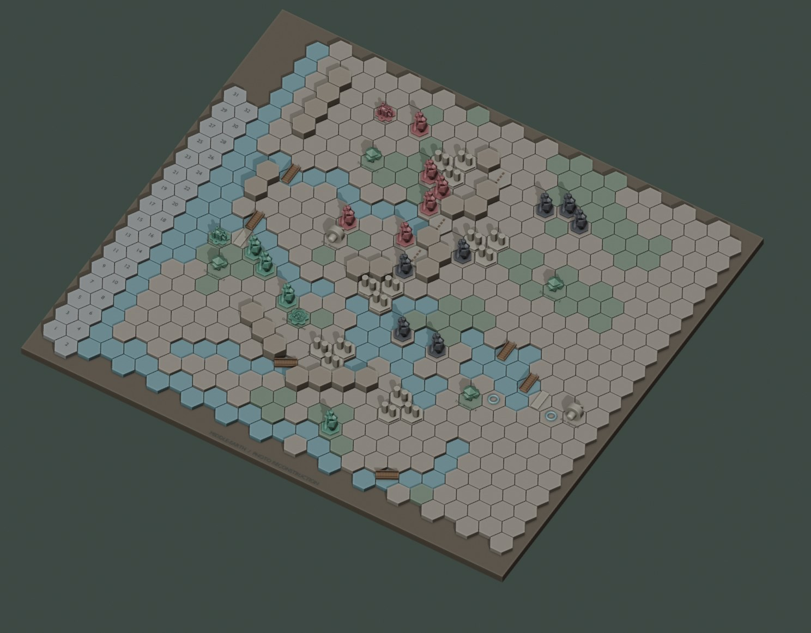

# A Middle-earth strategy board game

A hex-based strategy board game I designed from scratch: the board, the rules, the cards and the 3D-printed pieces. It plays a bit like Age of Empires on a tabletop. You expand from a capital, gather wood, iron and gold, build settlements and keeps, raise an army, and fight over the neutral strongholds of Middle-earth.

## The third playtest

This is the moment I'm proudest of. It was the third playtest, about an hour in. My friends stopped waiting on me to explain things and started playing each other. They were whispering tactics, trying to be deceptive, bluffing the other team, laughing and yelling. In my own words afterwards: *"that whole experience just burned into my mind, and I'm very proud of that."*

That hour is now the bar for everything I build, including [Project Reach](https://github.com/ccamer115/ProjectReach).

## How it plays

- **Up to four players**, one per quadrant of the map, each starting from a capital.
- **Each turn:** collect resources (wood, iron, gold), move, attack, build, then draw a spell card.
- **Combat with dice.** The attacker rolls its unit's dice, and the highest die must beat the target's defence. Archers and towers attack from two hexes away, cannons from three. Buildings lose one health per hit.
- **An economy on the map.** Lumber yards sit on forests and iron mines on dig sites. Settlements and keeps pay out every turn, and roads speed up movement.
- **Neutral strongholds.** Rivendell, Moria, Isengard, Helm's Deep and Minas Tirith are guarded by Orcs. Taking one pays gold every turn and gives a perk, like rerolling combat dice at Minas Tirith.
- **Three phases of event cards** change the game as it goes (sieges, a Balrog, the Eagles), and spells come in three tiers.
- **Win** by reaching 10 victory points (settlements are worth 1, keeps 2) or by taking an enemy capital.

| | |
|---|---|
|  |  |
| *Raised river and forest hexes, settlements and keeps* | *Printing and sorting the hex tiles* |

## How it was made

| When | What |
|---|---|
| Jul 2025 | First hex tiles modelled in CAD |
| Aug 2025 | The second version of the board |
| Sep 2025 | The third version of the board, with LED lighting driven by a microcontroller |
| Through Dec 2025 | Units, castles, keeps, towers and resource markers designed and printed |
| Jan 2026 | Version 2 of the rules written up |
| May 2026 | Event and spell cards |
| 2026 | The third board laid out as twelve map tiles in Miro, and playtested |
| Nov 2026 | A digital "design lab" built with AI help: a board editor, a Blender render of the table, and a Godot workshop where AI players take turns so the rules can be tested between playtests |

I designed about 38 of the parts myself in SolidWorks: hex tiles, mountains and passes, settlement hexes, board edges, the castle, keep and towers, simple units and resource markers.

## The digital design lab

To test balance between game nights, I had a digital version of the board built with AI help. It's a Godot editor where the map can be painted hex by hex and compared against a photo of the real table. It has a full set of pieces, and AI players can play out whole turns while you watch the log.

| | |
|---|---|
|  |  |
| *The board editor* | *AI players taking turns, with the log* |
|  |  |
| *The digital piece set* | *A render of the full table* |

---

*A non-commercial fan project. The Lord of the Rings, Middle-earth and their related names are trademarks of their respective owners. Some of the printed miniatures in the photos are other people's freely shared models. Everything else (the board, the rules, the cards and the CAD pieces) is my own design. Text and images © 2026 Costa Camerano.*
